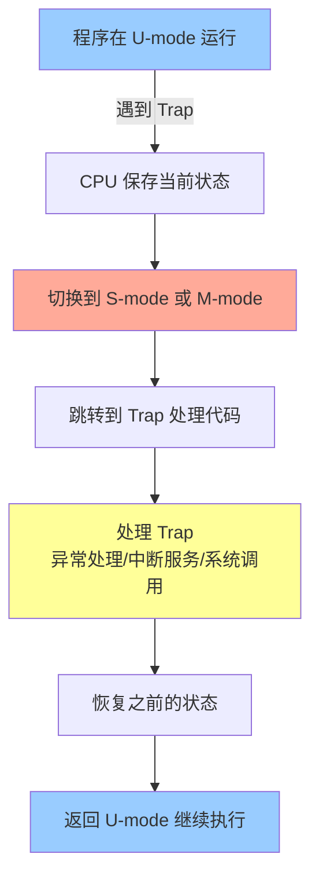

# 05 特权架构入门

**前置阅读**：[[04-内存栈与函数调用|← 04 内存栈与函数调用]]

## 你要学什么

前面几章你学了程序怎么用寄存器、内存、调用函数。但还有个问题：**如果程序想直接控制硬件（如读写磁盘、操作网卡），怎么办？**

**特权架构（Privilege Architecture）就是一套保护和管理机制，规定谁能做什么。**

### 为什么要学这个？

前面学的都是程序内部的事：计算、调用函数。但真实程序需要访问硬件：读文件、网络通信、显示图形。

**这一章解决的问题：**
- 为什么程序不能直接碰硬件？
- U-mode、S-mode、M-mode 是什么？
- 程序怎么请求操作系统帮忙（系统调用）？

学完后，你就能理解程序与操作系统的关系。下一章会教虚拟内存——操作系统怎么管理内存。

---

## 从生活例子开始

想象一个小区，有三种角色：

### 住户（U-mode，User Mode）

- **你的权限**：只能在自己家里活动，不能进别人家，不能碰电梯机房
- **能做什么**：做饭、看电视、算数（普通程序能做的事）
- **不能做什么**：不能改门禁密码、不能操作电梯、不能断电

### 物业管理员（S-mode，Supervisor Mode）

- **你的权限**：可以进入住户家（经过授权），可以管理公共区域，但不能碰核心机房
- **能做什么**：分配房间、管理访客登记、处理投诉（操作系统能做的事）
- **不能做什么**：不能操作总电源、不能改建筑结构

### 总管理员（M-mode，Machine Mode）

- **你的权限**：拥有所有权限，包括机房钥匙
- **能做什么**：控制总电源、修改门禁系统、紧急情况下接管一切
- **什么时候用**：启动时设置硬件、处理最底层的硬件故障

---

## 三种特权模式（Privilege Mode）

RISC-V 定义了三种模式，权限从低到高：

| 模式 | 英文 | 权限级别 | 能做什么 | 谁在用 |
|------|------|----------|----------|--------|
| **U-mode** | User | 0（最低） | 只能用普通指令，不能碰硬件 | 应用程序 |
| **S-mode** | Supervisor | 1 | 管理内存、处理异常、调度进程 | 操作系统内核 |
| **M-mode** | Machine | 3（最高） | 完全控制硬件 | 固件、启动代码 |

**为什么要分这么多层？**

1. **安全**：住户不能进别人家，程序不能访问别的程序的内存
2. **稳定**：一个程序崩溃不影响其他程序
3. **简化**：程序不需要知道硬件细节，操作系统帮你处理

---

## Trap：门禁报警系统

当住户（程序）试图做超出权限的事，门禁会报警，把事情交给管理员处理。

**Trap 就是这个机制：遇到异常情况时，CPU 把控制权转交给更高权限的代码。**

### Trap 的三种情况

#### 1. Exception（异常）

程序做了非法操作。

```asm
lw   x5, 0(x0)    # 试图访问地址 0（通常是非法的）
# → CPU 触发 Exception，跳到异常处理代码
```

**类比**：住户试图撬开机房门 → 门禁报警 → 物业介入

**常见异常**：
- 访问非法地址（Page Fault，页错误）
- 除以零
- 执行非法指令

#### 2. Interrupt（中断）

硬件发来通知："我有事找你"。

```asm
# 程序正常运行中...
add  x5, x5, 1
# → 定时器中断：时间到了！
# → CPU 暂停当前程序，跳到中断处理代码
```

**类比**：门铃响了，物业暂停手头工作去开门

**常见中断**：
- 定时器中断（Timer Interrupt）
- 外部设备中断（磁盘、网卡）

#### 3. Ecall（环境调用）

程序主动请求操作系统帮忙。

```asm
li   a7, 64       # 系统调用号 64 = write
ecall             # 请求操作系统执行 write
# → CPU 切换到 S-mode，执行系统调用
```

**类比**：住户打电话给物业："帮我开门"

**常见系统调用**：
- 读写文件
- 申请内存
- 创建进程

---

## Trap 处理流程



**关键步骤**：

1. **保存现场**：把当前的 PC、寄存器状态存起来
2. **切换模式**：从 U-mode 切换到 S-mode（或 M-mode）
3. **跳转处理**：跳到操作系统的 Trap 处理代码
4. **执行处理**：操作系统处理这个 Trap
5. **恢复现场**：恢复之前的 PC 和寄存器
6. **返回**：切回 U-mode，继续执行

---

## CSR：控制和状态寄存器

除了 `x0`-`x31` 这 32 个通用寄存器，CPU 还有一些特殊寄存器，叫 **CSR（Control and Status Register）**。

**类比**：小区管理系统的控制面板。

常用的 CSR：

| 寄存器 | 用途 | 谁能访问 |
|--------|------|----------|
| `mstatus` | Machine 模式状态 | M-mode |
| `sstatus` | Supervisor 模式状态 | S-mode 及以上 |
| `mtvec` | Machine Trap 处理地址 | M-mode |
| `stvec` | Supervisor Trap 处理地址 | S-mode 及以上 |
| `mepc` | Machine 异常返回地址 | M-mode |
| `sepc` | Supervisor 异常返回地址 | S-mode 及以上 |

**怎么用 CSR？**

```asm
csrr  x5, sstatus     # 读 CSR：把 sstatus 的值读到 x5
csrw  sstatus, x5     # 写 CSR：把 x5 的值写到 sstatus
```

**重要**：只有在对应的特权模式下才能访问 CSR。U-mode 试图访问 `sstatus` 会触发异常。

---

## 一个完整例子：系统调用

假设你的程序想输出 "Hello"，需要调用操作系统的 `write` 函数。

```asm
# 用户程序（U-mode）
li   a0, 1            # 文件描述符 1 = stdout
la   a1, hello_str    # 字符串地址
li   a2, 5            # 长度 5
li   a7, 64           # 系统调用号 64 = write
ecall                 # 触发系统调用

# → CPU 自动做这些事：
# 1. 保存当前 PC 到 sepc
# 2. 切换到 S-mode
# 3. 跳转到 stvec 指向的地址

# 操作系统（S-mode）
system_call_handler:
    # 根据 a7 的值，调用对应的函数
    # a7 == 64 → 调用 sys_write
    # 执行实际的硬件操作
    
    sret              # 返回 U-mode

# → CPU 自动做这些事：
# 1. 从 sepc 恢复 PC
# 2. 切换回 U-mode
# 3. 继续执行 ecall 的下一条指令

hello_str:
    .string "Hello"
```

---

## 为什么需要特权架构

### 没有特权保护会怎样？

如果所有程序都能直接碰硬件：

1. **不安全**：恶意程序可以读别的程序的内存，窃取密码
2. **不稳定**：一个程序错误可能让整个系统崩溃
3. **难管理**：多个程序抢占同一个硬件资源，打架

### 有了特权保护：

1. **隔离**：每个程序只能访问自己的内存
2. **共享**：操作系统协调硬件访问，避免冲突
3. **恢复**：一个程序崩溃，操作系统可以清理并重启它

---

## 你现在能做什么

看到这段代码：

```asm
li   a7, 93       # 系统调用号 93 = exit
li   a0, 0        # 退出码 0
ecall             # 退出程序
```

你应该能回答：

- 这是什么指令？（ecall，环境调用）
- 会发生什么？（触发 Trap，切换到 S-mode，执行系统调用）
- 谁来处理？（操作系统）
- 处理完怎么办？（用 `sret` 返回 U-mode）

---

## 下一步

等你理解了特权模式和 Trap，下一章会教你：

### 为什么要学虚拟内存？

现在你知道了程序与操作系统的关系，但还有个问题：多个程序同时运行时，怎么防止它们互相干扰？

**下一章会告诉你：**
- 虚拟地址 vs 物理地址是什么？
- 页表（Page Table）怎么翻译地址？
- 操作系统怎么让每个程序都觉得自己独占内存？

学完后，你就能理解操作系统怎么管理内存。再下一章会教扩展——怎么按需添加功能。

**[[06-虚拟内存与操作系统|→ 下一章：06 虚拟内存与操作系统]]**

---

## 深入阅读

- [[../atoms/privilege-mode|特权模式详解]]
- [[../atoms/CSR|CSR 详解]]
- [[../atoms/trap|Trap 详解]]
- [[../privileged/notes|特权架构笔记]]
