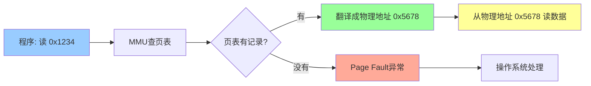
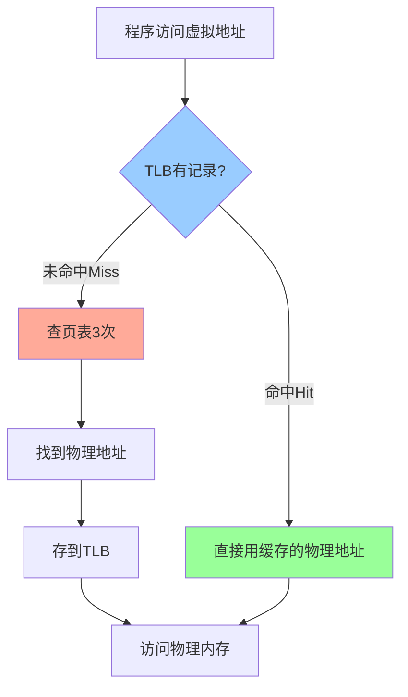

# 06 虚拟内存与操作系统

**前置阅读**：[[05-特权架构入门|← 05 特权架构入门]]

## 你要学什么

上一章你学了特权模式，知道程序不能直接碰硬件。但还有个问题：**多个程序同时运行时，怎么防止它们互相干扰？怎么让每个程序都觉得自己独占内存？**

**虚拟内存（Virtual Memory）就是操作系统给每个程序的"专属空间假象"。**

### 为什么要学这个？

前面学的都是单个程序的事情。但现实中，一台电脑同时运行几十个程序，它们都要用内存。

**这一章解决的问题：**
- 程序看到的地址不是真实地址？
- 页表怎么把虚拟地址翻译成物理地址？
- 为什么需要这套机制？

学完后，你就能理解操作系统怎么管理内存。下一章会教扩展——怎么按需添加功能。

---

## 从生活例子开始

想象你住酒店：

### 场景：客人入住

你拿到的房卡上写着"302号房"，你以为：
- 这是你的专属房间
- 你可以自由使用房间里的一切
- 不会进到别人的房间

**但实际上：**
- 前台可能把"302号"分配给东楼5层的某个房间
- 明天可能把"302号"改成西楼3层的另一个房间
- 其他客人拿的"302号"可能对应完全不同的物理房间

**你不需要知道真实的楼层和位置，只要用"302"就能找到你的房间。**

---

## 虚拟地址 vs 物理地址

在计算机里：

| 概念 | 酒店类比 | 计算机 |
|------|----------|--------|
| **虚拟地址（Virtual Address）** | 房卡上的号码"302" | 程序看到的地址 `0x1000` |
| **物理地址（Physical Address）** | 真实的楼层位置"东楼5层" | 内存条上的真实位置 |
| **页表（Page Table）** | 前台的登记簿 | 记录虚拟→物理映射的表格 |
| **TLB（Translation Lookaside Buffer）** | 前台脑子里记住的最近10位客人 | 缓存最近的地址翻译 |
| **操作系统** | 酒店前台 | 管理映射，分配内存 |

**程序永远不知道物理地址，只能用虚拟地址。**

---

## 为什么需要虚拟内存

### 1. 隔离保护（Protection）

**问题**：如果没有虚拟内存，程序A可能不小心（或故意）改写程序B的数据。

```
物理内存（没有虚拟内存）：
[程序A的数据] [程序B的数据] [程序C的数据]
    ↑             ↑
程序A可以访问    程序A也能访问（危险！）
```

**解决**：每个程序有自己的虚拟地址空间，操作系统确保它们的虚拟地址映射到不同的物理内存。

```
程序A看到：              程序B看到：
[0x0000 - 0xFFFF]       [0x0000 - 0xFFFF]
     ↓                       ↓
物理内存：
[程序A]                  [程序B]
程序A和B都从0x0000开始，但映射到不同的物理位置
```

### 2. 地址统一（Simplification）

**问题**：如果用物理地址，程序必须知道自己被加载到内存的哪里。

**解决**：所有程序都从 `0x0000` 开始，操作系统负责映射到实际位置。

### 3. 灵活管理（Flexibility）

**好处**：
- 程序可以比物理内存大（用硬盘做"虚拟内存"）
- 内存不够时，把不常用的页换到硬盘
- 物理内存可以不连续，虚拟地址仍然连续

---

## 地址翻译过程

### 最简单的例子

程序想读地址 `0x1234`：



**MMU（Memory Management Unit）** 是 CPU 里专门做地址翻译的硬件。

---

## 页（Page）和页表（Page Table）

内存不是一个字节一个字节映射的，而是分成固定大小的"页"。

**RISC-V 里一页 = 4KB（4096字节）**

### 为什么用页？

如果每个字节都记录映射，页表会超级大：
- 32位地址空间 = 4GB
- 如果每个字节都记录，需要 4GB 的页表（不可行！）

**用页映射：**
- 4GB ÷ 4KB = 1M 个页
- 每个页表项 4 字节，页表只需要 4MB（可接受）

### 地址拆分

虚拟地址分成两部分：

```
虚拟地址 0x12345678（假设）
┌─────────────────┬─────────────┐
│   页号 (VPN)    │  页内偏移    │
│   0x12345       │   0x678     │
└─────────────────┴─────────────┘
         ↓ 查页表翻译
物理地址 0xABCDE678
┌─────────────────┬─────────────┐
│   页号 (PPN)    │  页内偏移    │
│   0xABCDE       │   0x678     │
└─────────────────┴─────────────┘
                     ↑ 偏移不变
```

**页内偏移（Offset）不需要翻译，直接复制过去。**

---

## Sv39：RISC-V 的虚拟内存方案

RISC-V 64位系统用 **Sv39** 方案：
- **39位虚拟地址**（可以寻址 512GB）
- **三级页表**（像省-市-街道的层级结构）

### 为什么是三级？

如果用一级页表，需要一个超大表格（512GB ÷ 4KB = 128M 个表项 = 1GB 的表！）

**三级页表只在需要时创建下一级：**

```
虚拟地址 39位
┌──────┬──────┬──────┬────────────┐
│ VPN2 │ VPN1 │ VPN0 │   Offset   │
│ 9位  │ 9位  │ 9位  │   12位     │
└──────┴──────┴──────┴────────────┘
   │      │      │         │
   │      │      │         └─→ 页内偏移（4KB）
   │      │      └─────────→ 第3级页表索引
   │      └────────────────→ 第2级页表索引
   └───────────────────────→ 第1级页表索引
```

**类比：省-市-街道**
- 第1级：找到"广东省"的记录
- 第2级：找到"深圳市"的记录
- 第3级：找到"南山区XX街"的记录

如果程序只用了一小部分地址空间，大部分页表项不需要创建，节省内存。

---

## TLB：地址翻译缓存

每次访问内存都查页表太慢了（要访问3次内存！）。

**TLB（Translation Lookaside Buffer）= 最近翻译结果的缓存**



**类比**：前台记住最近10位客人的房间号，不用每次都翻登记簿。

**TLB命中率通常 > 95%**，所以地址翻译很快。

---

## 一个完整例子

假设程序要读虚拟地址 `0x123456789`（Sv39）：

```asm
lw   x5, 0(x10)    # x10 = 0x123456000（虚拟地址）
```

**步骤：**

1. **拆分虚拟地址**：
   ```
   0x123456000 (二进制省略)
   VPN2 = 0x48    (9位)
   VPN1 = 0x1A    (9位)
   VPN0 = 0x2B    (9位)
   Offset = 0x000 (12位)
   ```

2. **查TLB**：
   - 如果命中 → 直接得到物理地址
   - 如果未命中 → 继续查页表

3. **查三级页表**：
   ```
   a. 从 satp 寄存器拿到第1级页表基地址
   b. 用 VPN2 索引第1级页表 → 得到第2级页表地址
   c. 用 VPN1 索引第2级页表 → 得到第3级页表地址
   d. 用 VPN0 索引第3级页表 → 得到物理页号 PPN
   ```

4. **组合物理地址**：
   ```
   物理地址 = PPN + Offset
   例如：0xABCDE000 + 0x000 = 0xABCDE000
   ```

5. **访问物理内存**：
   从物理地址 `0xABCDE000` 读数据到 `x5`

---

## Page Fault：页错误

如果页表里没有对应的映射，CPU 触发 **Page Fault 异常**。

### 常见原因

1. **程序访问了非法地址**（如空指针）
   ```c
   int *p = NULL;
   *p = 5;  // → Page Fault
   ```

2. **页被换到硬盘了**（操作系统需要把它换回来）
   ```
   物理内存满了 → OS把不常用的页存到硬盘
   程序访问时 → Page Fault → OS从硬盘读回来
   ```

3. **写只读页**（如代码段）
   ```asm
   # 程序试图修改自己的代码
   sw   x5, 0(x10)  # x10 指向代码段 → Page Fault
   ```

**操作系统处理 Page Fault：**
1. 检查地址是否合法
2. 如果合法，分配物理内存，更新页表
3. 如果非法，终止程序（Segmentation Fault）

---

## satp 寄存器：页表基地址

操作系统通过 **satp（Supervisor Address Translation and Protection）** CSR 告诉 CPU 页表在哪里。

```asm
# 操作系统设置页表
la   t0, page_table_addr   # 页表物理地址
srli t0, t0, 12            # 右移12位（页对齐）
li   t1, (8 << 60)         # MODE=8 表示 Sv39
or   t0, t0, t1
csrw satp, t0              # 写入 satp

# 刷新 TLB（因为页表变了）
sfence.vma
```

**`satp` 格式（64位）：**
```
┌────────┬────────────────────────────┐
│  MODE  │          PPN               │
│  4位   │          44位              │
└────────┴────────────────────────────┘
MODE=8 → Sv39
MODE=0 → 禁用虚拟内存（直接用物理地址）
```

---

## 你现在能做什么

看到这段代码：

```c
int *p = (int *)0x1000;
*p = 42;
```

你应该能回答：

- `0x1000` 是什么地址？（虚拟地址）
- CPU 怎么找到真实位置？（通过页表翻译成物理地址）
- 如果页表里没有 `0x1000` 的映射会怎样？（Page Fault）
- 谁来处理 Page Fault？（操作系统）

---

## 虚拟内存的好处

| 好处 | 说明 | 例子 |
|------|------|------|
| **隔离** | 每个程序有独立地址空间 | 程序A崩溃不影响程序B |
| **保护** | 操作系统控制访问权限 | 代码段只读，不能被修改 |
| **简化** | 程序总是从 0x0 开始 | 不用考虑被加载到哪里 |
| **共享** | 多个程序共享同一物理页 | 动态库只加载一次 |
| **扩展** | 虚拟地址空间可以大于物理内存 | 用硬盘做"虚拟内存" |

---

## 下一步

等你理解了虚拟内存和页表，下一章会教你：

### 为什么要学标准扩展？

现在你已经掌握了 RISC-V 的核心知识：指令、函数、特权、虚拟内存。但还缺一块拼图：不同芝片为什么功能不一样？

**下一章会告诉你：**
- RV32I 只是基础，M/A/F/D/C/V 扩展是什么？
- 什么时候需要哪些扩展？
- 怎么选择适合你的指令集配置？

学完后，你就能看懂芝片规格，知道不同配置的优劣。再下一章会教微架构——为什么同样的指令集，性能差别巨大。

**[[07-标准扩展学习|→ 下一章：07 标准扩展学习]]**

---

## 深入阅读

- [[../02-特权架构/atoms/Sv39|Sv39 详解]]
- [[../02-特权架构/notes|特权架构笔记]]
- [[../05-调试与工具链/platform/notes|平台规范笔记]]
