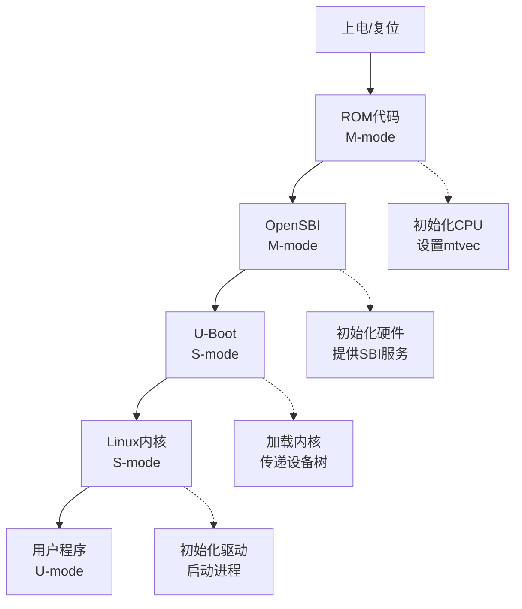

# 10 综合实践项目

**前置阅读**：[[09-平台调试与软件生态|← 09 平台调试与软件生态]]

## 你要学什么

前面学了这么多理论，现在要动手实践。

**核心思想：从简单到复杂，每个项目解决一个具体问题。**

### 为什么要做这些项目？

学了01-09章，知识还是分散的。就像学了单词、语法，还要通过写作文才能真正掌握。

**这一章通过5个项目：**
- 项目A：读汇编（巩固第2、3章）
- 项目B：函数调用（巩固第4章）
- 项目C：Trap处理（巩固第5章）
- 项目D：系统启动（巩固第5、6章）
- 项目E：RV32 vs RV64（巩固第7章）

完成后，你就能把所有知识串联起来，真正理解 RISC-V 的完整体系。这是整个学习路径的最后一步。

---

## 项目列表

| 项目 | 难度 | 主题 | 学到什么 |
|------|------|------|----------|
| **A** | ⭐ | 读懂汇编代码 | 寄存器、数据流动 |
| **B** | ⭐⭐ | 函数调用与栈 | 栈帧、返回地址 |
| **C** | ⭐⭐⭐ | 异常与Trap | 特权切换、系统调用 |
| **D** | ⭐⭐⭐⭐ | 系统启动流程 | ROM→BootLoader→OS |
| **E** | ⭐⭐ | RV32 vs RV64 | 架构对比 |

**建议顺序：A → B → C → E → D**

---

## 项目A：读懂汇编代码 ⭐

### 目标

给定一段汇编代码，能回答：
- 输入在哪个寄存器？
- 每条指令做了什么？
- 结果放在哪里？

### 任务

分析这段代码：

```asm
# 假设 x10 = 5, x11 = 3
add  x12, x10, x11    # 第1条
slli x13, x12, 1      # 第2条
addi x14, x13, 10     # 第3条
```

**填写表格：**

| 步骤 | 指令 | x10 | x11 | x12 | x13 | x14 | 说明 |
|------|------|-----|-----|-----|-----|-----|------|
| 初始 | - | 5 | 3 | ? | ? | ? | 输入 |
| 1 | add | 5 | 3 | ? | ? | ? | x12 = x10 + x11 = ? |
| 2 | slli | 5 | 3 | ? | ? | ? | x13 = x12 << 1 = ? |
| 3 | addi | 5 | 3 | ? | ? | ? | x14 = x13 + 10 = ? |

### 答案

| 步骤 | 指令 | x10 | x11 | x12 | x13 | x14 | 说明 |
|------|------|-----|-----|-----|-----|-----|------|
| 初始 | - | 5 | 3 | 0 | 0 | 0 | 输入 |
| 1 | add | 5 | 3 | **8** | 0 | 0 | x12 = 5 + 3 = 8 |
| 2 | slli | 5 | 3 | 8 | **16** | 0 | x13 = 8 << 1 = 16 |
| 3 | addi | 5 | 3 | 8 | 16 | **26** | x14 = 16 + 10 = 26 |

**结果：x14 = 26**

### 进阶练习

自己分析这段代码：

```asm
li   x5, 10           # x5 = 10
li   x6, 3            # x6 = 3
mul  x7, x5, x6       # x7 = x5 * x6
addi x7, x7, 5        # x7 = x7 + 5
```

**问题：**
1. 需要M扩展吗？（有`mul`指令）
2. 最终 x7 = ?
3. 这段代码计算的是什么？（10 × 3 + 5 = 35）

---

## 项目B：函数调用与栈 ⭐⭐

### 目标

理解函数调用时：
- 参数怎么传递
- 返回地址存在哪里
- 栈帧怎么分配和释放

### 任务

分析这个C函数的汇编：

```c
int add(int a, int b) {
    return a + b;
}

int main() {
    int result = add(5, 3);
    return result;
}
```

编译后的汇编（简化版）：

```asm
add:
    add  a0, a0, a1       # a0 = a0 + a1
    ret                   # 返回

main:
    addi sp, sp, -16      # 分配栈空间
    sw   ra, 12(sp)       # 保存返回地址
    
    li   a0, 5            # 第一个参数
    li   a1, 3            # 第二个参数
    call add              # 调用函数
    
    lw   ra, 12(sp)       # 恢复返回地址
    addi sp, sp, 16       # 释放栈空间
    ret                   # 返回
```

**填写表格：**

| 步骤 | 指令 | a0 | a1 | ra | sp | 栈[sp+12] |
|------|------|----|----|----|----|-----------|
| main开始 | - | ? | ? | 0x2000 | 0x1000 | ? |
| 分配栈 | addi sp | ? | ? | 0x2000 | ? | ? |
| 保存ra | sw ra | ? | ? | 0x2000 | 0xFF0 | ? |
| 传参 | li a0/a1 | ? | ? | 0x2000 | 0xFF0 | 0x2000 |
| call前 | - | 5 | 3 | 0x2000 | 0xFF0 | 0x2000 |
| call后(add执行) | add | ? | 3 | ? | 0xFF0 | 0x2000 |
| add ret后 | - | 8 | 3 | 0x2000 | 0xFF0 | 0x2000 |
| 恢复ra | lw ra | 8 | 3 | ? | 0xFF0 | 0x2000 |
| 释放栈 | addi sp | 8 | 3 | 0x2000 | ? | 0x2000 |

**问题：**
1. 为什么要保存 ra？
2. call 指令做了什么？（跳转 + 保存下一条指令地址到ra）
3. 栈是向上还是向下增长？（向下，地址变小）

---

## 项目C：异常与Trap ⭐⭐⭐

### 目标

理解程序出错或系统调用时，控制权怎么转移。

### 任务

分析这段触发异常的代码：

```asm
# 用户程序（U-mode）
li   x5, 0            # x5 = 0
lw   x6, 0(x5)        # 试图访问地址0（非法！）
# → 触发 Exception，跳到异常处理

# 异常处理程序（S-mode）
trap_handler:
    csrr t0, sepc     # 读取出错的PC
    csrr t1, scause   # 读取异常原因
    # ... 处理异常（可能终止程序）
    sret              # 返回（或不返回）
```

**填写流程：**

1. **正常执行**：`lw x6, 0(x5)` 执行前
   - 当前模式：U-mode
   - PC：0x1000

2. **触发异常**：访问地址0
   - CPU自动做什么？
     - [ ] 保存PC到sepc
     - [ ] 设置scause（异常原因码）
     - [ ] 切换到S-mode
     - [ ] 跳转到stvec（异常处理地址）

3. **异常处理**：trap_handler执行
   - sepc = ?（0x1000，出错的指令地址）
   - scause = ?（通常是5，Load Access Fault）

4. **返回或终止**：
   - 如果异常可恢复：`sret` 返回U-mode
   - 如果非法访问：操作系统终止程序

**问题：**
1. 为什么需要保存sepc？（知道哪条指令出错）
2. scause有什么用？（区分不同异常类型）
3. 用户程序能直接调用sret吗？（不能，S-mode专属）

---

## 项目D：系统启动流程 ⭐⭐⭐⭐

### 目标

理解从上电到操作系统运行的完整流程。

### 任务

画出启动流程图：



**每个阶段做什么：**

| 阶段 | 特权级 | 任务 | 关键寄存器 |
|------|--------|------|-----------|
| **ROM** | M-mode | 最基本初始化，跳转到BootLoader | mtvec, mstatus |
| **OpenSBI** | M-mode | 硬件抽象层，提供SBI接口 | medeleg, mideleg |
| **U-Boot** | S-mode | 加载内核，传递设备树 | satp, stvec |
| **Linux** | S-mode | 操作系统内核 | satp, sstatus |
| **App** | U-mode | 用户应用程序 | - |

**问题：**
1. 为什么OpenSBI运行在M-mode？（需要完全控制硬件）
2. Linux能直接访问硬件吗？（不能，通过SBI调用）
3. 设备树（Device Tree）有什么用？（告诉OS硬件配置）

---

## 项目E：RV32 vs RV64 ⭐⭐

### 目标

对比32位和64位RISC-V的区别。

### 任务

填写对比表：

| 特征 | RV32 | RV64 |
|------|------|------|
| **寄存器宽度** | 32位 | 64位 |
| **寄存器名** | x0-x31 | x0-x31（相同） |
| **地址空间** | 4GB（2³²） | 16EB（2⁶⁴，实际常用39位=512GB） |
| **指令长度** | 32位 | 32位（相同） |
| **指令示例** | `lw`（load word=4字节） | `ld`（load doubleword=8字节） |
| **C类型** | `long` = 32位 | `long` = 64位 |
| **应用场景** | 嵌入式、IoT | 服务器、桌面 |

**代码对比：**

```c
// C代码
long x = 1000000000;
```

**RV32汇编：**
```asm
li   x5, 1000000000   # 一条指令可能不够，需要lui+addi
```

**RV64汇编：**
```asm
li   x5, 1000000000   # 同样可能需要多条指令
```

**问题：**
1. RV32能运行64位程序吗？（不能）
2. RV64能运行32位程序吗？（能，兼容RV32）
3. 为什么不直接用RV64？（嵌入式场景，32位够用且更省资源）

---

## 你现在能做什么

完成这5个项目后，你应该能：

1. ✅ 读懂任何RV32I/RV64I汇编代码
2. ✅ 理解函数调用的完整过程
3. ✅ 知道异常和系统调用怎么工作
4. ✅ 理解系统启动的各个阶段
5. ✅ 对比不同RISC-V配置的差异

---

## 下一步

如果你完成了所有项目，可以：

1. **深入Linux**：学习 [[11-Linux与RISC-V|Linux与RISC-V]]
2. **硬件设计**：学习Chisel，设计自己的RISC-V核心
3. **优化性能**：学习编译器优化，写高效的汇编代码
4. **扩展学习**：深入V扩展（向量）、H扩展（虚拟化）

**恭喜你完成了RISC-V入门！🎉**

**[[11-Linux与RISC-V|→ 可选深入：11 Linux与RISC-V]] | [[学习记录|→ 记录你的学习进度]]**

---

## 深入阅读

- [[../01-isa基础/notes|ISA 笔记]]
- [[../software/notes|软件生态笔记]]
- [[../02-特权架构/notes|特权架构笔记]]
- [[../platform/notes|平台规范笔记]]
- [[11-Linux与RISC-V|Linux 与 RISC-V]]
