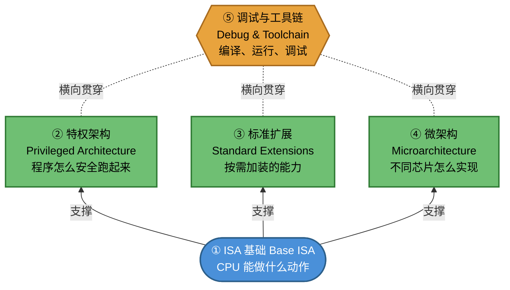

---
tags: [home, index, riscv, concept-map]
domain: all
date: 2026-08-06
---

# RISC-V 概念地图 (RISC-V Concept Map)

> 目的：用一张"树"把整个知识库的概念关系说清楚。顶层最简单，往下越具体。
> 遇到看不懂的词，不用慌——先看它在树上属于哪个分支，再决定要不要点进去查细节。
> 关键术语第一次出现时会标注英文原词，方便你以后查英文资料时能对上号。

---

## 第 0 层：一句话心智模型 (Mental Model)

**RISC-V 是一套"搭积木"式的处理器设计规范（Instruction Set Architecture，ISA）：**
从一个只有 47 条指令的最小内核（Base ISA）开始，按需叠加"权限管理"（Privileged Architecture）和"功能扩展"（Extensions），
不同厂商再用不同的实现方式（Microarchitecture）把它做成芯片，最后配上工具链（Toolchain）让人能写代码、调试、运行。

记住这一句话，下面的树只是把这句话拆开讲。读完整篇后回到这句话——你会发现每个分支正好对应句子里的一个词。

---

## 第 1 层：五个分支，谁依赖谁

真正的关系是"分层堆叠"，不是并列关系。像盖房子一样，先看地基，再看上面盖了什么：

蓝色框是地基，绿色框是建立在地基上的三个平行方向。

橙色框（⑤工具链）用虚线连接而不是实线箭头，因为它和②③④不是"上下叠加"关系，而是"谁都要用它"的关系：写特权架构代码要用编译器和调试器，写标准扩展代码（如向量运算）也要用同一套编译器和调试器，研究微架构性能还是要用模拟器和分析工具。工具链不专属于②③④中任何一个，而是三者都会用到的通用手段——这就是虚线想表达的意思。

**依赖关系（从下往上理解）：**
- ①（ISA 基础，Base ISA）是地基，②③④都建立在①之上，但②③④彼此之间没有依赖关系，是平行的三个方向
- ②（特权架构，Privileged Architecture）解决"多个程序/内核共用一个 CPU 时怎么隔离"的问题
- ③（标准扩展，Standard Extensions）是可选装的能力包，装不装不影响①②能不能跑
- ④（微架构，Microarchitecture）是"同样的指令集，不同厂商造出快慢不同的芯片"——这是实现细节，不改变①②③定义的行为
- ⑤（调试与工具链，Debug & Toolchain）不是硬件概念，而是"人怎么和②③④打交道"的通用手段，不属于堆叠关系里的某一层，所以图上用虚线而不是叠加箭头连接

---

## 第 2 层：每个分支具体讲什么

### ① ISA 基础 —— "CPU 认识哪些指令"

**一句话**：定义了寄存器（Register）、指令编码（Instruction Encoding）、基本运算，是最小可运行的指令集。

| 概念 | 一句话说明 | 详细页面 |
|------|-----------|---------|
| hart (Hardware Thread) | CPU 里真正执行指令的"执行单元"，每个 hart 有独立的 PC 和寄存器 | [[atoms/hart]] |
| XLEN | 寄存器有多宽（32/64 位），决定能管多大内存和做多大的运算 | [[atoms/XLEN]] |
| RV32I / RV64I | 最小指令集，只有 47 条指令，但足够跑操作系统和应用程序 | [[atoms/RV32I]] |

**系统学习入口**：[[learning_path/01-计算机与RISC-V入门]] → [[learning_path/02-RV32I基础指令]]  
**查词典入口**：[[01-isa基础/vocabulary|ISA 词汇表]]

---

### ② 特权架构 (Privileged Architecture) —— "程序怎么安全地碰硬件"

**一句话**：把 CPU 运行状态分成 M/S/U 三个权限等级（Privilege Mode），出错或需要特殊操作时统一走陷阱（Trap）机制处理。

| 概念 | 一句话说明 | 详细页面 |
|------|-----------|---------|
| privilege mode (特权模式) | M(固件层) > S(操作系统层) > U(应用程序层) 三级权限，权限越低能碰的资源越少 | [[atoms/privilege-mode]] |
| CSR (Control and Status Register) | 控制 CPU 行为、读取 CPU 状态的专用寄存器 | [[atoms/CSR]] |
| trap (陷阱) | 异常（Exception）和中断（Interrupt）的统一处理机制 | [[atoms/trap]] |
| Sv39 | 64 位系统最常用的虚拟内存（Virtual Memory）分页方案 | [[atoms/Sv39]] |

**系统学习入口**：[[learning_path/05-特权架构入门]] → [[learning_path/06-虚拟内存与操作系统]]  
**查词典入口**：[[02-特权架构/vocabulary|特权架构词汇表]]

---

### ③ 标准扩展 (Standard Extensions) —— "按需加装的能力"

**一句话**：基础指令集不够用时，按需求叠加乘除法、原子操作、向量运算等扩展。

| 概念 | 一句话说明 | 详细页面 |
|------|-----------|---------|
| M 扩展 (Multiplication) | 加装硬件乘除法，不然要软件模拟，慢 10-30 倍 | [[atoms/extension-M]] |
| A 扩展 (Atomic) | 加装原子指令（Atomic Instruction），多核编程（锁、无锁数据结构）的基础 | [[atoms/extension-A]] |
| C 扩展 (Compressed) | 加装 16 位压缩指令，省 25-30% 代码体积 | [[atoms/extension-C]] |
| V 扩展 (Vector) | 加装向量运算（SIMD），一份代码能在不同硬件宽度上跑 | [[atoms/extension-V]] |

**系统学习入口**：[[learning_path/07-标准扩展学习]]  
**查词典入口**：[[03-标准扩展/vocabulary|扩展词汇表]]

---

### ④ 微架构 (Microarchitecture) —— "同样指令集，为什么性能差 10 倍"

**一句话**：指令集只规定"做什么"，不规定"怎么做"，芯片厂商可以用流水线（Pipeline）、乱序执行（Out-of-Order Execution）、缓存（Cache）等技术实现，性能因此天差地别。

**详细页面**：[[microarch/vocabulary|微架构词汇表]]（流水线、分支预测、缓存、乱序执行）

**系统学习入口**：[[learning_path/08-CPU微架构入门]]

---

### ⑤ 调试与工具链 (Debug & Toolchain) —— "怎么把代码变成能跑的程序"

**一句话**：编译器（Compiler）把代码变成指令，模拟器（Simulator）/开发板负责运行，调试器（Debugger）负责在出问题时让你看清 CPU 内部状态。

**详细页面**：[[debug/vocabulary|调试词汇表]] · [[software/vocabulary|软件生态词汇表]] · [[platform/vocabulary|平台词汇表]]

**系统学习入口**：[[learning_path/09-平台调试与软件生态]] → [[learning_path/10-综合实践项目]]

---

## 三种文档，三种用法

这份知识库里有三类文档，别搞混：

| 文档类型 | 干什么用 | 什么时候看 |
|---------|---------|-----------|
| **本文件（概念地图）** | 告诉你"这个词属于哪个分支，分支之间什么关系" | 迷路了、不知道从哪学起时 |
| **learning_path/ 系列课程** | 按顺序、一步步教，有例子有自测 | 想系统学完一遍时 |
| **atoms/ 和 vocabulary.md** | 词典式参考，定义+表格+来源 | 已经知道要查什么具体术语时 |

**推荐路径**：先读本文件建立全局框架（5分钟）→ 按 learning_path 顺序系统学习 → 学习过程中遇到生词，回来查 atoms/vocabulary 补细节。

---

## 回到开头：闭环一下

再读一次第 0 层的那句话：

> RISC-V 是一套"搭积木"式的处理器设计规范：从一个只有 47 条指令的最小内核开始，
> 按需叠加"权限管理"、"功能扩展"，不同厂商再用不同方式把它做成芯片，
> 最后配上工具链让人能写代码、调试、运行。

现在你应该能对上号了：
- "最小内核" = ①ISA 基础（地基）
- "权限管理" = ②特权架构
- "功能扩展" = ③标准扩展
- "不同厂商用不同方式做成芯片" = ④微架构
- "配上工具链" = ⑤调试与工具链

这五个词撑起了整个知识库。以后不管学到多细的术语，都可以先问自己一句：**这个词属于哪个分支？** 找到分支，就找到了它在整张地图上的位置。

---

**下一步**：[[learning_path/00-学习导航]]
