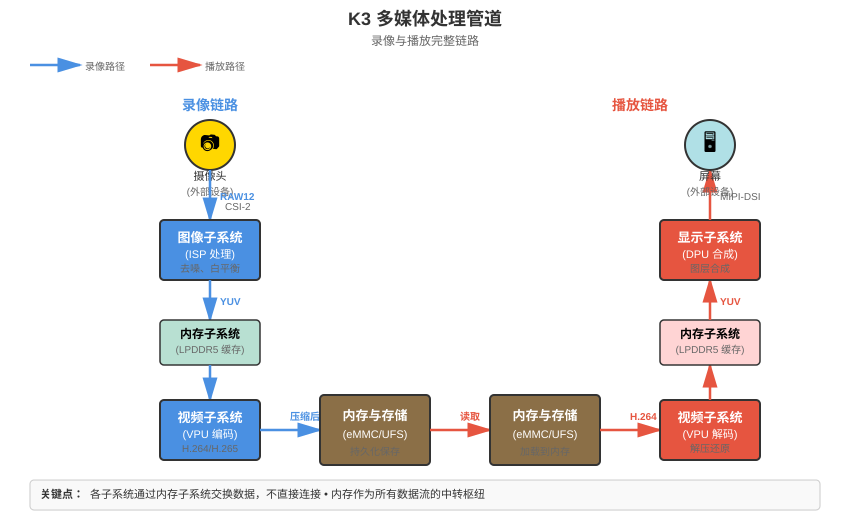

---
tags: [study, m2, peripherals, image, video, display, spacemit]
domain: chip
aliases: [外设子系统, Peripherals Subsystem]
status: needs_review
created: 2026-11-19
updated: 2026-11-25
---

# 外设子系统概览

> **本讲目标**：理解图像、视频、显示三个子系统的分工，理解一条完整的数据流如何从摄像头经过处理最后输出到屏幕。
> 
> **📌 说明**：本模块以 **K3** 为例讲解外设子系统，但摄像头接口（CSI）、图像处理（ISP）、视频编解码（VPU）、显示输出等概念适用于所有 SoC 芯片。

## 一、三个子系统的分工

K3 的多媒体处理分三个子系统：

| 子系统 | 英文 | 负责什么 | 输入 | 输出 |
|---|---|---|---|---|
| 图像子系统 | Image Subsystem | 摄像头输入、ISP 处理 | 原始图像（RAW） | 处理后的图像（YUV） |
| 视频子系统 | Video Subsystem | 编码与解码 | 原始视频（YUV） | 压缩视频（H.264/H.265） |
| 显示子系统 | Display Subsystem | 屏幕输出 | 帧缓冲（Framebuffer） | MIPI-DSI 或 DP/eDP 信号 |

**数据流示例**（录像）：
```
摄像头 → 图像子系统（ISP）→ 内存（YUV）→ 视频子系统（编码）→ 内存（H.264）→ 存储（eMMC）
```

**数据流示例**（播放）：
```
存储（H.264）→ 内存 → 视频子系统（解码）→ 内存（YUV）→ 显示子系统 → 屏幕
```

**关键点**：每个子系统处理完后都把数据写回内存，下一个子系统从内存读取。它们不直接连接。

**完整流程可视化**（录像 + 播放）：



## 二、图像子系统：从摄像头到 ISP

**MIPI-CSI2**（Mobile Industry Processor Interface - Camera Serial Interface 2）是摄像头与芯片之间的接口标准。

K3 有 4 个 CSI 控制器，每个支持最多 4 条数据通道（lane），单通道最高速率 1.5 Gbps。

**为什么需要多通道？**
- 高分辨率摄像头产生的数据量大，单通道[带宽](GLOSSARY.md#带宽)不够。
- 4K 30fps RAW12 图像需要约 3 Gbps [带宽](GLOSSARY.md#带宽)，需要至少 2 条通道。

**[ISP](GLOSSARY.md#isp)**（Image Signal Processor，图像信号处理器）把摄像头的原始图像（RAW 格式）转换成可用的图像（YUV 格式）。

**主要功能**：去噪、白平衡、曝光补偿、颜色校正。

## 三、视频子系统：编码与解码

**[VPU](GLOSSARY.md#vpu)**（Video Processing Unit，视频处理单元）是 K3 的视频编解码加速器，最高运行频率 1 GHz。

**编码能力**：4K@90fps H.264/H.265 编码，同时支持 4K@60fps 编码 + 解码。  
**解码能力**：4K@180fps H.264/H.265 解码，支持 AV1、VP8、VP9、MPEG4、MPEG2、H.263。

**价值**：原始 4K 30fps 视频每秒约 373 MB，H.265 编码后可以压缩到每秒 10 MB 左右（[压缩比](GLOSSARY.md#编码压缩比)约 37:1）。VPU 用专用硬件加速，编码同时 CPU 还能做其他事。

## 四、显示子系统：从内存到屏幕

**显示控制器**（Display Controller）把内存中的帧缓冲数据传输到屏幕。

**支持的输出接口**：
- **MIPI-DSI**（Display Serial Interface）：用于手机、平板、嵌入式屏幕，最高 4K@60fps。
- **DP/eDP**（DisplayPort / embedded DisplayPort）：用于显示器、笔记本，最高 4K@60fps。

K3 有 2 个 DPU（Display Processing Unit，显示处理单元），可以同时输出到 2 个屏幕。

**图层合成**（Layer Composition）：
- 支持最多 4 个全尺寸图层同时显示（例如背景、视频窗口、UI、鼠标指针）。
- 通过 RDMA 通道复用，最多可支持 16 个图层。

**[AFBC](GLOSSARY.md#afbc)**（Arm Frame Buffer Compression）：帧缓冲压缩格式，减少内存带宽占用。压缩后的帧缓冲可以直接被显示控制器读取并解压显示。

## 快速自测

1. 图像子系统、视频子系统、显示子系统各自负责什么？
2. 为什么 4K 摄像头需要多通道 CSI 接口？
3. VPU 相比软件编码的优势是什么？
4. K3 最多可以同时输出到几个屏幕？

## 参考来源

| 来源 | 章节 | 内容 |
|---|---|---|
| docs-chip · key_stone/k3/k3_docs/k3_ds.md | 2.3.1 MIPI 摄像头接口 | CSI 控制器数量、通道、速率 |
| docs-chip · key_stone/k3/k3_docs/k3_ds.md | 2.3.2 ISP | 图像信号处理器的功能 |
| docs-chip · key_stone/k3/k3_docs/k3_ds.md | 2.4.1 VPU 简介 | VPU 的编解码能力、运行频率 |
| docs-chip · key_stone/k3/k3_docs/k3_ds.md | 2.4.2 视频编码器 | 4K@90fps 编码、同编同解 |
| docs-chip · key_stone/k3/k3_docs/k3_ds.md | 2.5.1 显示控制器 | DPU 数量、图层合成、AFBC |
