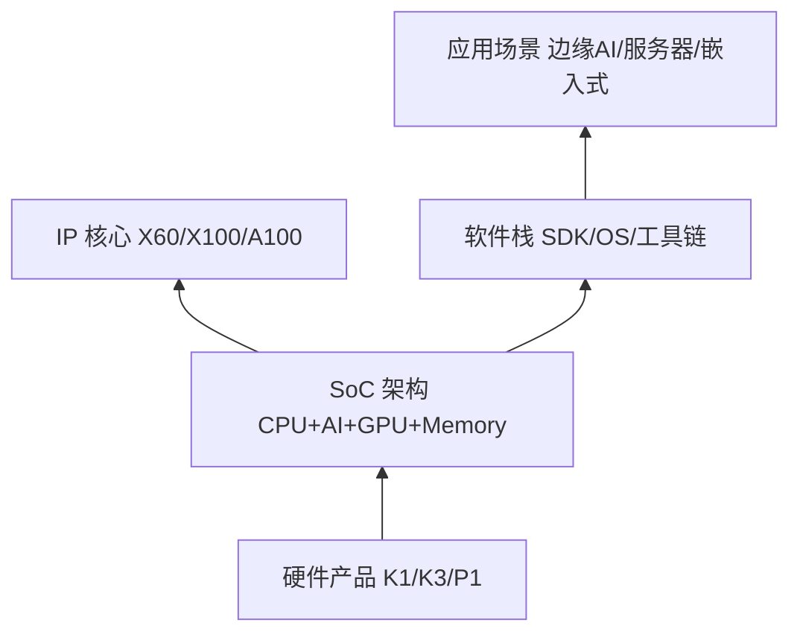

# SpacemiT 概念地图 (SpacemiT Concept Map)

> 目的：用一张"树"把 SpacemiT 芯片与文档体系的概念关系说清楚。顶层最简单，往下越具体。  
> 遇到看不懂的词，先看它在树上属于哪个分支，再决定要不要点进去查细节。  
> 关键术语第一次出现时会标注英文原词或对应的 NVIDIA/RISC-V 类比概念，方便你跨厂商对照。

---

## 第 0 层：一句话心智模型 (Mental Model)

**SpacemiT 是一家做 RISC-V AI 芯片与生态的公司：**  
从自研的 **X60/X100/X200 CPU 核心**（类比 ARM Cortex-A 或 NVIDIA GPU SM 的 CPU 对应物）开始，  
加上 **AI 加速核心**（如 A100，类比 NVIDIA Tensor Core），  
配上 **SDK/工具链/操作系统移植**（类比 NVIDIA 的 CUDA Toolkit + cuDNN），  
最后封装成 **K1/K3 等产品**（类比 NVIDIA 的 H100/A100 GPU 卡），  
让客户能用 RISC-V 芯片做边缘 AI、服务器推理、嵌入式计算。

记住这一句话，下面的树只是把这句话拆开讲。读完整篇后回到这句话——你会发现每个分支正好对应句子里的一个词。

---

## 第 1 层：五个分支，谁依赖谁

真正的关系是"分层堆叠"，不是并列关系。像盖房子一样，先看地基，再看上面盖了什么：

**依赖关系**（从下往上读）：
1. **IP 核心**（最底层）— X60/X100 CPU、A100 AI 核心，是 SpacemiT 自研的"积木块"  
2. **SoC 架构** — 把这些 IP 核心组装成完整的芯片（K1 = 8×X60 CPU + AI 扩展；K3 = 8×X100 CPU + 8×A100 AI）  
3. **软件栈** — Buildroot/Bianbu/OpenHarmony SDK，让芯片能跑程序  
4. **硬件产品** — K1/K3 芯片 + 开发板（MUSE Pi/Pico-ITX 等）  
5. **应用场景** — 最终用户拿这些产品去做本地大模型推理、机器人控制、边缘服务器等

**阅读顺序建议**：
- 如果你是**技术新手**：从第 2 层"软件栈"或第 1 层"硬件产品"开始（看得见摸得着的东西），再往下探 SoC 架构。
- 如果你是**SpacemiT 文档专员**做跨厂商调研：直接跳到第 3 层"SoC 架构"和第 4 层"IP 核心"，对比 NVIDIA/RISC-V 同类概念。

---

## 第 2 层：SoC 架构（SpacemiT 芯片的"零件清单"）

一颗完整的 SpacemiT SoC 包含这些子系统：

### 2.1 计算核心（CPU + AI）

- **[[X60-Core]]**：SpacemiT 自研 RISC-V CPU 核心，面向边缘泛 AI 应用（K1 采用，类比 ARM Cortex-A55）
- **[[X100-Core]]**（假设已有或待建）：高性能 RISC-V CPU（K3 采用，类比 ARM Cortex-A76 或 X1）
- **[[A100-AI-Core]]**（假设已有或待建）：专用 AI 矩阵运算核心（K3 独有，类比 NVIDIA Tensor Core）
- **AI 扩展指令**：X60 的部分型号带 AI 自定义指令（如 `smt.vmadot`），类比 NVIDIA 的 WMMA 指令

**跨厂商对照**：
- SpacemiT X60/X100 ↔ ARM Cortex-A 系列 ↔ RISC-V SiFive U74/P550（都是 CPU 核）
- SpacemiT A100 ↔ NVIDIA Tensor Core ↔ Google TPU 的矩阵单元（都是 AI 专用硬件）

### 2.2 内存子系统

- **[[HBM]]**（概念占位）：高带宽内存（SpacemiT 现有产品未采用，但文档中作为对照概念存在）
- **LPDDR4/4x/5**：K1 用 LPDDR4x @ 2666 Mbps，K3 用 LPDDR5-6400（类比 NVIDIA GPU 的 HBM 但成本更低）
- **缓存层次**：L1/L2 Cache + TCM（Tightly-Coupled Memory，类比 NVIDIA Shared Memory）

**跨厂商对照**：
- K3 LPDDR5 64-bit @ 6400 Mbps ↔ NVIDIA H100 HBM3 @ 3.35 TB/s（带宽差 50 倍，但功耗/成本取舍不同）

### 2.3 多媒体与显示

- **GPU**：IMG BXE 系列（K1 用 BXE-2-32，K3 用 BXE-4-64，类比 ARM Mali 或 Qualcomm Adreno）
- **VPU**：硬件视频编解码器（4K/8K H.265/H.264）
- **ISP**：图像信号处理器（支持多摄，最高 48MP）
- **显示接口**：MIPI DSI、eDP、HDMI

### 2.4 互连与外设

- **PCIe**：K1 Gen2，K3 Gen3 x4（类比 NVIDIA NVLink 但用标准协议）
- **USB / Ethernet / CAN / I²C / SPI** 等标准外设

---

## 第 3 层：软件栈（如何用这些芯片）

### 3.1 操作系统层

- **[[Bianbu]]**：基于 Ubuntu 的 RISC-V 优化系统（类比 NVIDIA 的 Linux for Tegra）
- **[[Buildroot]]**：轻量级嵌入式 Linux BSP
- **[[OpenWrt]]**：面向网络设备的 Linux 发行版
- **[[OpenHarmony]]**：原生 RISC-V OpenHarmony 5.0/6.x（K1/K3 首发）
- **[[ROS2]]**：机器人操作系统 SDK

### 3.2 开发工具

- **[[SDK]]**：完整 BSP（OpenSBI + U-Boot/UEFI + Kernel + Rootfs）
- **[[Cross-Compilation-Toolchain]]**：riscv64-unknown-linux-gnu-gcc 等工具链
- **[[Flashing-Tool]]** / **[[JTAG-Debugging]]** / **[[Trace-Tool]]**：烧录、调试、性能分析

### 3.3 AI 软件栈（重点对照 NVIDIA）

- **[[AI-SDK]]** / **[[LLM-SDK]]**：本地大模型推理 SDK（类比 NVIDIA TensorRT-LLM）
- **[[Ollama]]** / **[[localAI]]**：开源 LLM 推理框架移植
- **[[LangChain]]** / **[[LlamaIndex]]**：AI 应用框架集成

**跨厂商对照**：
- SpacemiT AI SDK ↔ NVIDIA TensorRT + cuDNN ↔ Qualcomm Snapdragon Neural Processing SDK

---

## 第 4 层：硬件产品（你能买到的实物）

### 4.1 芯片系列

- **[[K1]]**：8×X60 CPU（双簇，Cluster0 带 AI 扩展），~2 TOPS AI，LPDDR4x，面向单板机/消费级（类比树莓派 5 但是 RISC-V + AI）
- **[[K3]]**：8×X100 CPU + 8×A100 AI，60 TOPS AI，LPDDR5-6400，面向边缘服务器/本地大模型（可运行 30B 参数模型）
- **[[P1]]** / **[[P1S]]**：PMIC 电源管理芯片（配套 K1/K3 使用）

### 4.2 开发板与套件

- **K1 MUSE 系列**：Pi / Pi Pro / Book / Box / Card 等形态（类比树莓派生态）
- **K3 Pico-ITX / CoM260**：工业标准开发板与核心板

---

## 第 5 层：应用场景（最终用户用它做什么）

- **边缘 AI 推理**：K1 可运行 0.5B-1B 参数模型，K3 可运行 30B 参数模型
- **单板计算机**：教学、开发、轻量服务器（K1）
- **智能机器人**：ROS2 + AI SDK（四足机器人、服务机器人）
- **嵌入式视觉**：ISP + VPU + AI 加速（智能摄像头、无人机）
- **边缘服务器**：替代 x86/ARM 的 RISC-V 云原生方案

---

## 跨厂商术语对照入口

想知道某个 SpacemiT 概念在 NVIDIA/RISC-V/ARM 生态里叫什么、有何异同？  
→ **[[跨厂商术语对照表]]**

---

## 下一步

- 如果你想**快速了解某个产品**：跳到 [[atoms/products/K1]] 或 [[atoms/products/K3]]
- 如果你想**学习某个子系统**（如内存、多媒体）：从第 2 层的相关小节进入，查看 `[[wikilink]]` 链接的独立词条
- 如果你是**SpacemiT 文档专员做调研**：先看完本图建立整体框架，再去 [[跨厂商术语对照表]] 找对应关系，最后回到 `spacemit/PROGRESS.md` 看哪些领域需要补全
